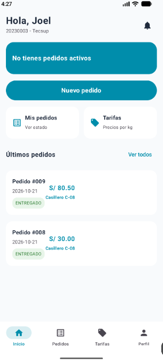
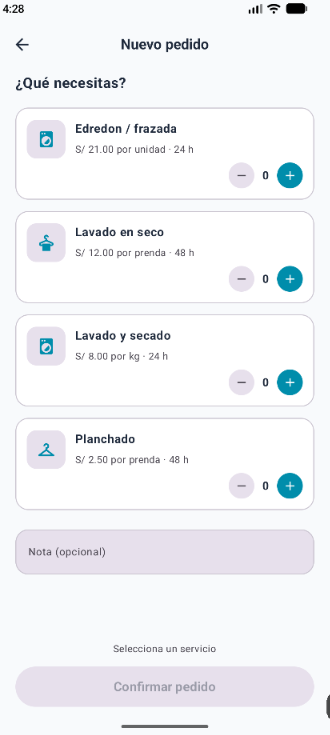
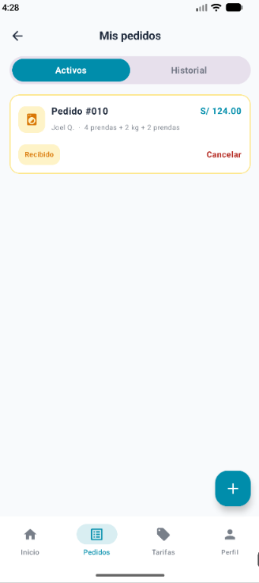
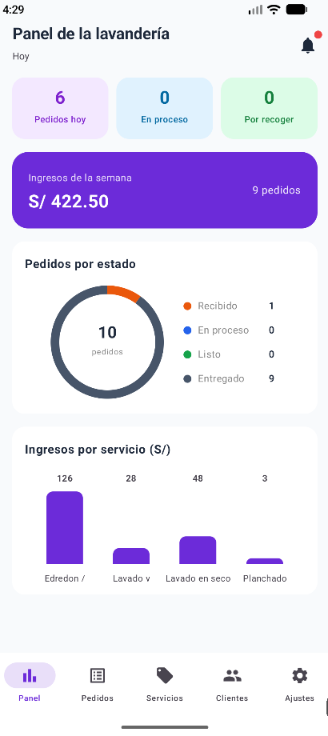
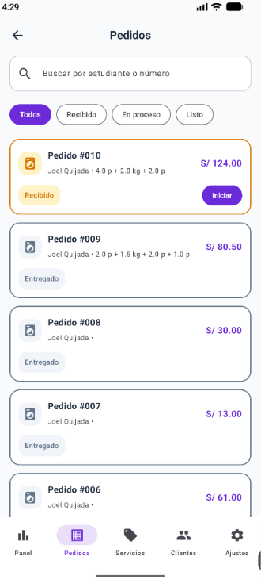
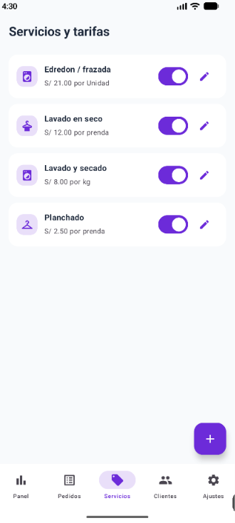

# LavaCampus - Sistema de Gestión de Lavandería

LavaCampus es una aplicación móvil nativa desarrollada en Android (Kotlin y Jetpack Compose) diseñada para gestionar el servicio de lavandería en campus universitarios. Permite a los estudiantes solicitar pedidos de lavado/planchado y realizar el seguimiento en tiempo real, mientras que los administradores pueden gestionar pedidos, casilleros, tarifarios de servicios y visualizar métricas operativas.

---

## Arquitectura y Patrón de Diseño (MVVM)

La aplicación sigue los principios de **Clean Architecture** recomendados por Android, implementando el patrón **MVVM (Model-View-ViewModel)** orientado a flujos reactivos con **Kotlin Coroutines** y **StateFlow**.

```
       ┌────────────────────────────────────────────────────────┐
       │                   VISTA (UI)                           │
       │  (Jetpack Compose: Screens, Components, Navigation)    │
       └──────────────────────────┬─────────────────────────────┘
                                  │ Eventos de UI
                                  ▼
       ┌────────────────────────────────────────────────────────┐
       │                  VIEWMODEL                             │
       │   (StateFlow, MutableStateFlow, CoroutineScope)        │
       └──────────────────────────┬─────────────────────────────┘
                                  │ Expone Estados (StateFlow)
                                  ▼
       ┌────────────────────────────────────────────────────────┐
       │                 REPOSITORIO                            │
       │         (LavaRepository / LavaRepositoryRoom)          │
       └──────────────┬──────────────────────────┬──────────────┘
                      │                          │
                      ▼                          ▼
       ┌────────────────────────┐      ┌────────────────────────┐
       │    BASE DE DATOS       │      │     PREFERENCIAS       │
       │   (Room Database /     │      │   (DataStore /         │
       │      DAOs)             │      │ PreferenciasStore)     │
       └────────────────────────┘      └────────────────────────┘
```

---

## Árbol de Paquetes del Proyecto

```
com.tecsup.lavacampus
├── data
│   ├── local
│   │   ├── dao
│   │   │   ├── DetalleDao.kt
│   │   │   ├── PedidoDao.kt
│   │   │   ├── ServicioDao.kt
│   │   │   └── UsuarioDao.kt
│   │   ├── entity
│   │   │   ├── DetallePedido.kt
│   │   │   ├── Pedido.kt
│   │   │   ├── Servicio.kt
│   │   │   └── Usuario.kt
│   │   ├── relation
│   │   │   ├── DatosIniciales.kt
│   │   │   └── LavaDataBase.kt
│   ├── prefs
│   │   └── PreferenciasStore.kt
│   └── repository
│       ├── LavaRepository.kt
│       └── LavaRepositoryRoom.kt
├── model
│   ├── Casilleros.kt
│   ├── ClienteResumen.kt
│   ├── EstadoPedido.kt
│   ├── IngresServicio.kt
│   ├── LineaPedido.kt
│   ├── Rol.kt
│   └── Unidad.kt
├── ui
│   ├── administrador
│   │   ├── AjustesScreen.kt
│   │   ├── BandejaScreen.kt
│   │   ├── ClientesScreen.kt
│   │   ├── FormularioServicioScreen.kt
│   │   ├── GestionPedidoScreen.kt
│   │   ├── PanelScreen.kt
│   │   └── ServiciosScreen.kt
│   ├── components
│   │   ├── AppTopBar.kt
│   │   ├── EstadoPedidoChip.kt
│   │   ├── IconoServicio.kt
│   │   ├── LavaButton.kt
│   │   ├── LavaTextField.kt
│   │   ├── PedidoCard.kt
│   │   ├── SelectorCantidad.kt
│   │   └── StepperEstado.kt
│   ├── estudiante
│   │   ├── DetallePedidoScreen.kt
│   │   ├── InicioScreen.kt
│   │   ├── LoginScreen.kt
│   │   ├── MisPedidosScreen.kt
│   │   ├── NuevoPedidoScreen.kt
│   │   ├── PerfilScreen.kt
│   │   ├── SplashScreen.kt
│   │   └── TarifasScreen.kt
│   ├── graficos
│   │   ├── GraficoBarras.kt
│   │   └── GraficoDona.kt
│   ├── navigation
│   │   ├── NavLava.kt
│   │   └── Rutas.kt
│   └── theme
│       ├── Color.kt
│       ├── Theme.kt
│       └── Type.kt
└── viewmodel
    ├── BandejaViewModel.kt
    ├── ClientesViewModel.kt
    ├── DetallePedidoViewModel.kt
    ├── GestionPedidoViewModel.kt
    ├── InicioViewModel.kt
    ├── MisPedidosViewModel.kt
    ├── NuevoPedidoViewModel.kt
    ├── PanelViewModel.kt
    ├── ServiciosViewModel.kt
    └── SesionViewModel.kt
```

---

## Capturas de Pantalla

### Vista Estudiante
| Inicio | Nuevo Pedido | Detalle de Pedido |
| :---: | :---: | :---: |
|  |  |  |

### Vista Administrador
| Panel Principal | Bandeja de Pedidos | Gestión de Servicios |
| :---: | :---: | :---: |
|  |  |  |

---

## Preguntas "Para pensar"

1. **¿Por qué la persistencia local con Room mejora la experiencia respecto a mantener los datos únicamente en memoria?**
   > Mantiene el estado de la aplicación incluso cuando el proceso es destruido por el sistema operativo o se reinicia el dispositivo. Además, permite un funcionamiento offline rápido y fluido, garantizando la integridad de las transacciones (como la creación de pedidos y asignación de casilleros).

2. **¿Qué ventajas tiene exponer flujos reactivos (`StateFlow` / `Flow`) desde el Repositorio hasta la Interfaz de Usuario?**
   > Permite que la UI reaccione automáticamente a cualquier cambio en la base de datos subyacente de manera asíncrona y sin acoplamiento directo. Cuando Room actualiza una tabla, `StateFlow` emite el nuevo estado y Jetpack Compose recompone únicamente los elementos de interfaz afectados.

3. **¿Cómo garantiza la separación de roles (Estudiante / Administrador) la seguridad operacional dentro de la navegación?**
   > Al gestionar grafos o rutas condicionales basadas en el estado del `Usuario` cargado en sesión (`SesionViewModel`), la UI restringe el acceso a pantallas administrativas (como asignación de casilleros o cobro de pedidos) a usuarios con rol `CLIENTE`, evitando navegaciones no autorizadas o modificaciones accidentalmente en el dominio de datos.