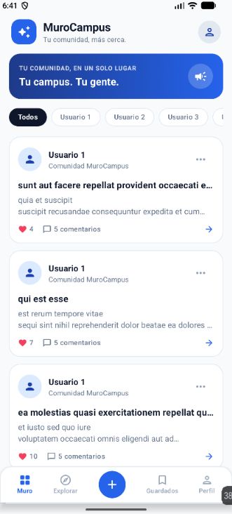
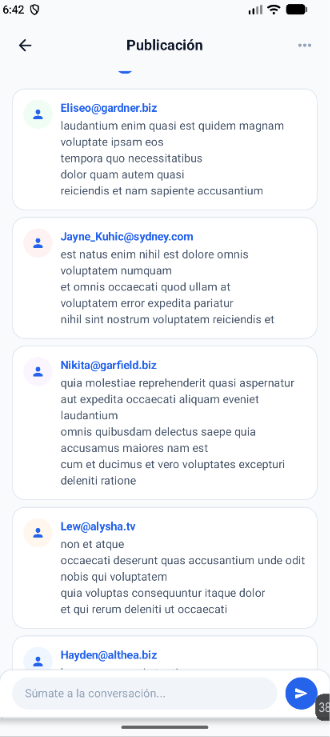
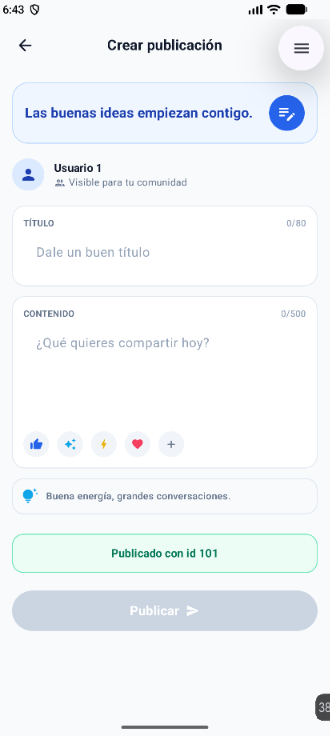
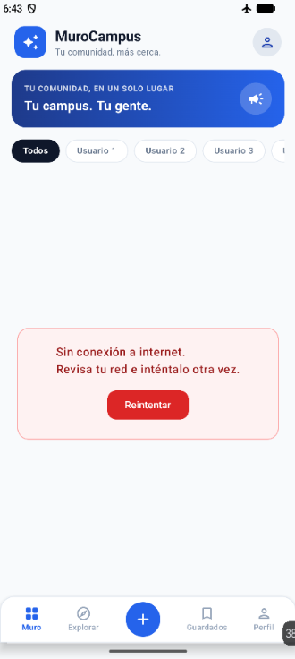

# MuroCampus — Cliente Android con Jetpack Compose y Retrofit

**MuroCampus** es una aplicación móvil nativa para Android desarrollada en **Kotlin** con **Jetpack Compose**, diseñada bajo la arquitectura **MVVM + Repository** y siguiendo la metodología **Spec-Driven Development (SDD)**. La aplicación consume la API REST de [JSONPlaceholder](https://jsonplaceholder.typicode.com/) para listar publicaciones, consultar detalles y comentarios, filtrar contenidos por usuario y publicar nuevas entradas mediante peticiones HTTP asíncronas con corrutinas.

---

## 📁 Estructura del Proyecto

```text
com.tecsup.murocampus/
├── MainActivity.kt               # Actividad principal y orquestación de navegación por estado
├── model/
│   └── Modelos.kt                # Data classes serializables: Post, Comentario, NuevoPost
├── data/
│   ├── PostRepository.kt         # Interface PostRepository y PostRepositoryRemote (retorna Result<T>)
│   └── remote/
│       ├── PostApi.kt            # Interface Retrofit con anotaciones HTTP (@GET, @POST, @Path, @Query, @Body)
│       └── RetrofitClient.kt     # Singleton de Retrofit y OkHttp con HttpLoggingInterceptor
├── viewmodel/
│   ├── UiState.kt                # Sealed interface UiState<out T> y mapeo de excepciones mensajeDe()
│   ├── PostsViewModel.kt         # ViewModel gestor de estados reactivos (StateFlow)
│   └── PostsViewModelFactory.kt  # Fábrica para inyección de dependencias del ViewModel
└── ui/
    ├── Componentes.kt            # TarjetaPost, Cargando y ErrorConReintento reutilizables
    ├── PantallaLista.kt          # Vista principal con banner, chips de filtro y lista
    ├── PantallaDetalle.kt        # Vista de detalle de publicación con comentarios
    ├── PantallaCrear.kt          # Formulario para publicar nuevos post (POST)
    └── theme/                    # Configuración del tema corporativo azul (Color, Theme, Type)
```

---

## 🏛️ Arquitectura MVVM + Repository

La aplicación respeta estrictamente la separación de responsabilidades y la regla de flujo unidireccional de datos:

```text
+-------------------------------------------------------------------------------+
|                             CAPA DE PRESENTACIÓN                              |
|                                (Jetpack Compose)                              |
|                                                                               |
|   [PantallaLista]         [PantallaDetalle]          [PantallaCrear]          |
|          │                       │                          │                 |
|          └───────────────────────┼──────────────────────────┘                 |
|                                  │ Eventos de UI / Navegación                 |
|                                  ▼                                            |
|                     collectAsStateWithLifecycle()                             |
|                                  │                                            |
+----------------------------------┼--------------------------------------------+
                                   │
                                   ▼
+-------------------------------------------------------------------------------+
|                                CAPA VIEWMODEL                                 |
|                               (PostsViewModel)                                |
|                                                                               |
|  StateFlow<UiState<List<Post>>>   StateFlow<UiState<DetalleUi>>   StateFlow... |
|                                  │                                            |
|                           viewModelScope.launch                               |
|                                  │                                            |
+----------------------------------┼--------------------------------------------+
                                   │
                                   ▼
+-------------------------------------------------------------------------------+
|                                CAPA REPOSITORY                                |
|                       (PostRepository / PostRepositoryRemote)                  |
|                                                                               |
|   Envuelve peticiones en helper llamar { ... }                                |
|   Maneja Result.success(datos) / Result.failure(exception)                    |
|   Captura CancellationException sin tragarla (throw e)                        |
|                                  │                                            |
+----------------------------------┼--------------------------------------------+
                                   │
                                   ▼
+-------------------------------------------------------------------------------+
|                             CAPA REMOTA / RED                                 |
|                       (PostApi + RetrofitClient + OkHttp)                     |
|                                                                               |
|   GET /posts         GET /posts/{id}     GET /posts/{id}/comments             |
|   GET /posts?userId  POST /posts                                              |
|                                  │                                            |
+----------------------------------┼--------------------------------------------+
                                   │ HTTP Request / Response (JSON)
                                   ▼
                   https://jsonplaceholder.typicode.com/
```

---

## 📸 Capturas de Pantalla

| Vista | Captura |
| :--- | :---: |
| **Lista de Publicaciones** |  |
| **Detalle y Comentarios** |  |
| **Filtro por Usuario** |  |
| **Crear Publicación** |  |
| **Error sin Conexión** |  |

---

## 💡 Para Pensar: Cuestionario Técnico

### 1. ¿Qué diferencia hay entre `GET` y `POST`? ¿Por qué `crear` lleva `@Body` y `porUsuario` lleva `@Query`?
- **`GET` vs `POST`**: `GET` es un método HTTP seguro e idempotente diseñado para consultar y obtener datos sin alterar el estado del servidor. `POST` es un método no idempotente utilizado para enviar datos hacia el servidor con el fin de procesar y crear un nuevo recurso.
- **`@Query` vs `@Body`**: `@Query("userId")` le indica a Retrofit que agregue parámetros de consulta codificados en la URL (`GET /posts?userId=2`), lo cual es ideal para filtrar resultados. En cambio, `@Body` le indica a Retrofit que tome el objeto Kotlin (`NuevoPost`), lo serialice a JSON y lo coloque directamente en el cuerpo (body) del paquete HTTP Request enviando una petición `POST`.

### 2. ¿Por qué la ruta es `"posts"` y no `"/posts"`?
En Retrofit, cuando la URL base (`baseUrl`) finaliza con una barra inclinada (`https://jsonplaceholder.typicode.com/`), las rutas relativas en las anotaciones deben definirse **sin la barra inicial** (`"posts"`). Si se escribiera `"/posts"`, Retrofit resolvería la URL tratando la ruta como una ruta absoluta desde la raíz del dominio, descartando cualquier subcarpeta o prefijo especificado en la URL base.

### 3. ¿Por qué el `Repository` devuelve `Result` en vez de dejar que la excepción llegue al `ViewModel`?
El Repository encapsula la fuente de datos y aísla al ViewModel de las tecnologías de red o almacenamiento. Devuelve `Result<T>` (`Result.success` o `Result.failure`) para convertir excepciones técnicas (`IOException`, `SerializationException`) en un contenedor explícito de éxito o fallo. Esto evita que el ViewModel se acople con librerías de red y simplifica las pruebas unitarias. Asimismo, es vital capturar y relanzar `CancellationException` para permitir que el sistema de Corrutinas cancele tareas activas cuando el usuario abandona la pantalla o destruye la vista.

### 4. ¿Qué pasa si olvidas el permiso `INTERNET`? ¿Y si olvidas `ignoreUnknownKeys` y el servidor agrega un campo nuevo?
- **Permiso `INTERNET` faltante**: La aplicación fallará al intentar abrir conexiones de red arrojando una excepción `SecurityException` o `UnknownHostException` en tiempo de ejecución.
- **`ignoreUnknownKeys = true` faltante**: Si la API del servidor se actualiza e incluye nuevos campos JSON que no forman parte de nuestras `data class`, el parser de `kotlinx.serialization` arrojará una `SerializationException` ("UnknownKeyException") colapsando la lectura. Usar `ignoreUnknownKeys = true` garantiza resiliencia ante la evolución del backend.

### 5. ¿Por qué la pantalla de lista usa un `when` sobre `UiState` y no un `if` con tres variables booleanas?
Modelar el estado mediante una `sealed interface UiState<out T>` (`Cargando`, `Exito`, `Error`) garantiza la existencia de un **Estado Único de la Verdad (Single Source of Truth)**. Si se utilizaran múltiples variables booleanas independientes (`isLoading`, `isError`, `isSuccess`), se podrían generar combinaciones imposibles e inconsistentes en la UI (por ejemplo, `isLoading = true` y `isSuccess = true` simultáneamente). Al usar `sealed interface`, el compilador de Kotlin verifica exhaustivamente la expresión `when`, obligando a manejar cada estado sin inconsistencias.

### 6. JSONPlaceholder no guarda los `POST`. ¿Cómo cambiaría tu app si usaras un servicio real?
En JSONPlaceholder, la petición `POST /posts` simula la creación respondiendo con un código `201 Created` y un identificador ficticio (`id = 101`), pero no almacena el objeto en su base de datos real.
En un entorno de producción con un backend real:
1. Al recibir la confirmación `201 Created` con el recurso creado, la app actualizaría la fuente local de datos (insertándolo en la base de datos local `Room` o añadiéndolo a la lista reactiva en memoria del `ViewModel`).
2. El `ViewModel` emitiría el nuevo estado para que la vista recargue automáticamente el listado mostrando la publicación recién agregada al inicio de la pantalla.
