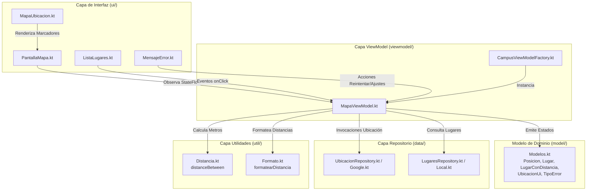
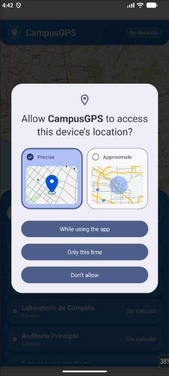
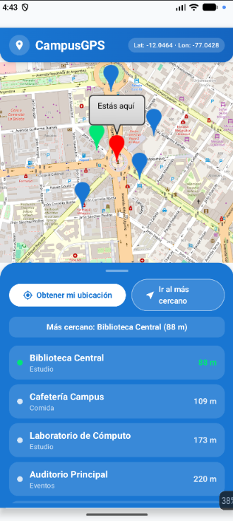
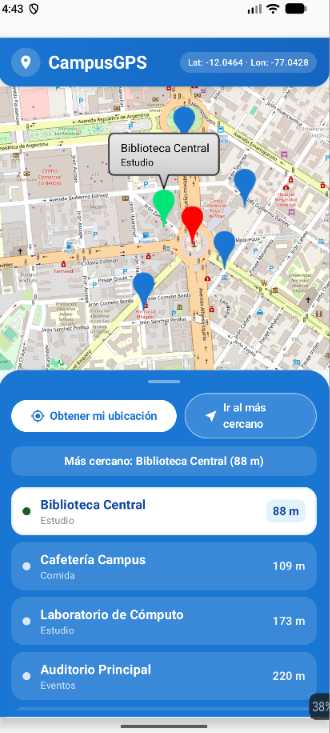
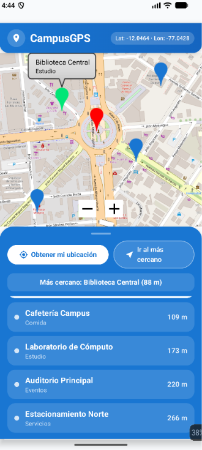
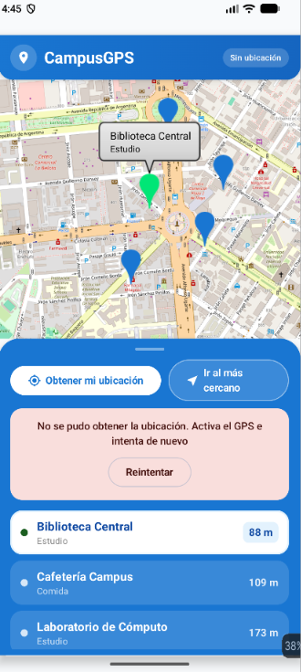

# CampusGPS — Aplicación de Geolocalización y Puntos de Interés

* **Proyecto:** CampusGPS
* **Autor:** Joel Quijada
* **Paquete Base:** `com.quijada.campusgps`
* **Rama de Trabajo:** `sin-ia`
* **Stack Tecnológico:** Kotlin, Jetpack Compose, Material 3, Google Play Services Location, OpenStreetMap (`osmdroid-android`).
* **Arquitectura:** MVVM + Repository Pattern (Interfaces).

---

## 1. Descripción del Proyecto

**CampusGPS** es una aplicación móvil nativa para Android diseñada para la geolocalización en tiempo real y el cálculo de proximidad hacia puntos de interés dentro de un campus universitario.

### Características Principales
* **Geolocalización en Tiempo Real:** Detección de la posición del usuario mediante `FusedLocationProviderClient` de Google Play Services.
* **Mapa Interactivo Abierto:** Integración de cartografía OpenStreetMap (`osmdroid`) en Jetpack Compose mediante `AndroidView`, permitiendo visualización fluida de tiles cartográficos en alta definición sin costos de API Keys de Google Cloud.
* **Cálculo y Ordenamiento por Distancia:** Cálculo preciso en metros entre la ubicación actual y los lugares registrados utilizando `Location.distanceBetween` (fórmula de Haversine), ordenando automáticamente la lista de menor a mayor distancia.
* **Identificación del Lugar Más Cercano:** Resaltado visual en color verde del marcador del lugar más cercano en el mapa e indicación en la lista inferior, con botón de navegación directa hacia dicho punto.
* **Selección Interactiva:** Selección bidireccional entre la lista de lugares y el mapa con desplazamiento animado de cámara (`zoom 17.5f`) y despliegue automático de globos informativos (`InfoWindow`).
* **Manejo Resiliente de Errores:** Gestión de permisos de ubicación en tiempo de ejecución, detección de GPS desactivado y verificación de Google Play Services con flujos de recuperación (botón "Reintentar" y redirección a "Abrir ajustes").

---

## 2. Estructura de Paquetes (`com.quijada.campusgps`)

```text
com.quijada.campusgps/
├── MainActivity.kt                 # Punto de entrada, inyección manual vía CampusViewModelFactory
├── model/
│   └── Modelos.kt                  # Data classes (Posicion, Lugar, LugarConDistancia) y sealed UbicacionUi
├── data/
│   ├── UbicacionRepository.kt      # Contrato de interfaz para ubicación y Play Services
│   ├── UbicacionRepositoryGoogle.kt# Implementación con FusedLocationProviderClient y GoogleApiAvailability
│   ├── LugaresRepository.kt        # Contrato de interfaz para lugares del campus
│   └── LugaresRepositoryLocal.kt   # Fuente de datos local con los 5 lugares de Lima
├── util/
│   ├── Distancia.kt                # Función pura distanciaMetros() con Location.distanceBetween
│   └── Formato.kt                  # Función pura formatearDistancia() (m / km)
├── viewmodel/
│   ├── MapaViewModel.kt            # Gestión de estado, ordenamiento, selección y errores
│   └── CampusViewModelFactory.kt   # Fábrica para instanciar MapaViewModel
└── ui/
    ├── PantallaMapa.kt             # Scaffold principal, barra superior y panel inferior azul
    ├── MapaUbicacion.kt            # Componente OpenStreetMap (osmdroid) en AndroidView con marcadores
    ├── ListaLugares.kt             # LazyColumn de lugares ordenados con selección e indicador más cercano
    ├── MensajeError.kt             # Tarjeta de error resiliente (Ajustes / Reintentar)
    └── theme/                      # Paleta de colores e identidades visuales Material 3
```

---

## 3. Diagrama de Arquitectura (MVVM + Repository)



---

## 4. Capturas de Pantalla

| Escenario |              Vista Previa               | Descripción |
| :--- |:---------------------------------------:| :--- |
| **01. Diálogo de Permisos** |         | Solicitud de permisos `ACCESS_FINE_LOCATION` y `ACCESS_COARSE_LOCATION` en tiempo de ejecución. |
| **02. Ubicación Obtenida** |     | Posición actual detectada, mapa centrado en las coordenadas y marcador rojo "Estás aquí". |
| **03. Marcador Más Cercano** |   | Marcadores azules en el campus con el lugar más cercano (Biblioteca Central) resaltado en verde. |
| **04. Lista Ordenada y Selección** |             | `LazyColumn` ordenada por distancia de menor a mayor; al tocar un elemento, el mapa centra la cámara a zoom 17.5f. |
| **05. Manejo Resiliente de Error** |             | Pantalla de error ante GPS desactivado o permisos denegados con opciones de "Reintentar" o "Abrir ajustes". |

---

## 5. Para Pensar

### 1. ¿Por qué `FusedLocationProviderClient` está dentro del Repository y no en el ViewModel?
Está dentro de `UbicacionRepositoryGoogle` para cumplir estrictamente con el principio de responsabilidad única (SRP) y la arquitectura en capas recomendada por Android (Clean Architecture / MVVM). 

`FusedLocationProviderClient` es un componente de bajo nivel atado al framework de Android (`Context`, Google Play Services). Si se colocara directamente dentro de `MapaViewModel`, el ViewModel importaría clases del SDK de Android, impidiendo la ejecución de pruebas unitarias puras en la JVM sin depender del entorno Android. Al encapsularlo tras la interfaz `UbicacionRepository`, el ViewModel solo interactúa con contratos puros de Kotlin (`Posicion?`), quedando totalmente desacoplado de las API de hardware y permitiendo sustituir el proveedor de ubicación fácilmente.

---

### 2. ¿Qué diferencia hay entre el permiso de ubicación y la clave de API de Maps? ¿Qué pasa si falta cada uno?
* **Permiso de Ubicación (`ACCESS_FINE_LOCATION` / `ACCESS_COARSE_LOCATION`):** Es la autorización legal que otorga el usuario en tiempo de ejecución para acceder a la antena GPS del teléfono. Si falta el permiso, la llamada a `fusedLocationClient` falla lanzando `SecurityException` o retornando nulo, impidiendo conocer las coordenadas del usuario.
* **Clave de API de Maps (`MAPS_API_KEY`):** Es una credencial de autenticación emitida por Google Cloud Console para consumir los servidores de mapas de Google. Si falta o es inválida en Google Maps, la vista del mapa no puede cargar los tiles cartográficos y se muestra en gris con marcas de agua.
* **Uso de OpenStreetMap (`osmdroid`):** En este proyecto se utilizó OpenStreetMap mediante la librería `osmdroid-android` envuelta en `AndroidView` de Jetpack Compose. Esto permite solicitar tiles cartográficos libres (`TileSourceFactory.MAPNIK`) sin requerir facturación activa ni tarjetas de crédito en Google Cloud, manteniendo `local.properties` como resguardo seguro de credenciales externas.

---

### 3. ¿Por qué la clave va en `local.properties` y no en el código? ¿Qué harías si se subiera a GitHub por error?
* **Por qué va en `local.properties`:** `local.properties` es un archivo excluido del control de versiones mediante `.gitignore`. Al almacenar claves allí y leerlas desde `app/build.gradle.kts` mediante `Properties().load(...)`, se inyectan en tiempo de compilación (`manifestPlaceholders`), previniendo que secretos o tokens queden expuestos en el código fuente o repositorios públicos.
* **Plan de remediación si se sube a GitHub por error:**
  1. **Revocación inmediata:** Acceder a Google Cloud Console > Credentials y revocar/eliminar inmediatamente la clave filtrada.
  2. **Creación de nueva clave:** Generar una nueva API Key y aplicar restricciones estrictas de aplicación (Package Name `com.quijada.campusgps` y huella SHA-1 del certificado debug/release).
  3. **Limpieza del historial Git:** Ejecutar herramientas de purga como `git filter-repo` o `BFG Repo-Cleaner` para eliminar el commit que contenía la clave en el historial de Git antes de forzar el push (`git push --force`).

---

### 4. ¿Dónde calculas la distancia y por qué no en el Composable?
* **Dónde se calcula:** La distancia se calcula en la capa ViewModel (`MapaViewModel.kt`) ejecutando la función pura `distanciaMetros(desde, hasta)` ubicada en `util/Distancia.kt`, la cual internamente usa `Location.distanceBetween`.
* **Por qué NO en el Composable:**
  1. **Rendimiento:** Las funciones `@Composable` se recomponen frecuentemente ante cambios de estado, desplazamientos o animaciones. Realizar cálculos matemáticos en la vista bloquearía el hilo principal de UI (*UI Thread*), provocando caídas de fotogramas y lag visual (*jank*).
  2. **Arquitectura:** Las vistas deben ser tontas (*dumb views*); su única función es renderizar el estado proporcionado. Toda lógica de cálculo, ordenamiento (`.sortedBy { it.metros }`) y formateo pertenece al ViewModel y utilidades.

---

### 5. ¿Qué pasa con tu app si el usuario niega el permiso dos veces? ¿Cómo lo manejas?
* **Comportamiento del SO:** Si el usuario rechaza el permiso dos veces, el sistema Android activa automáticamente la política *"Don't ask again"* (No volver a preguntar), desactivando el diálogo emergente del sistema al invocar `permissionLauncher.launch()`.
* **Manejo en CampusGPS:** 
  1. El callback detecta que el permiso sigue denegado y notifica a `vm.permisoDenegado()`.
  2. El ViewModel emite el estado `UbicacionUi.Error(..., TipoError.SIN_PERMISO)`.
  3. La interfaz captura este estado y renderiza el composable `MensajeError` con una tarjeta en `errorContainer` y el botón **"Abrir ajustes"**.
  4. Al hacer clic en *"Abrir ajustes"*, se dispara un `Intent` explícito (`Settings.ACTION_APPLICATION_DETAILS_SETTINGS` apuntando a `package:com.quijada.campusgps`), guiando al usuario a otorgar el permiso manualmente. Al regresar a la app, `LifecycleEventObserver` en `ON_RESUME` detecta que el permiso fue concedido y reanuda la búsqueda automáticamente.
