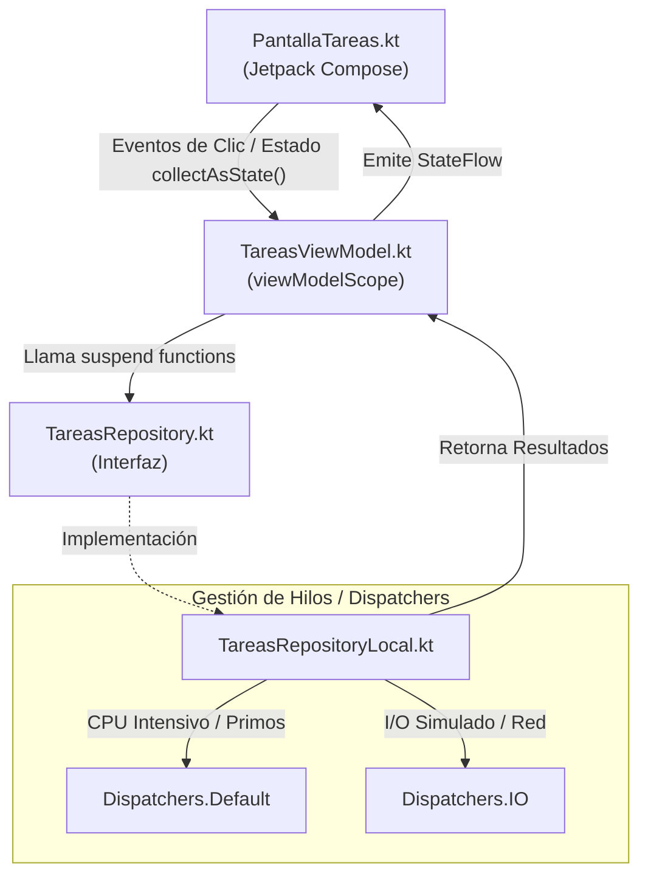
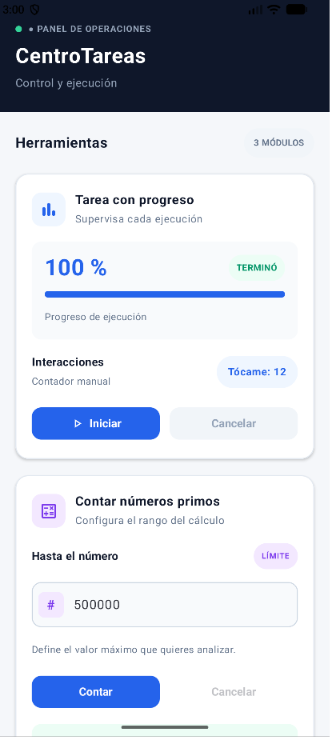
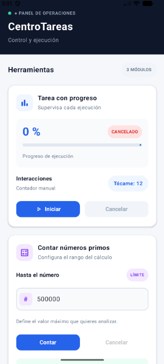
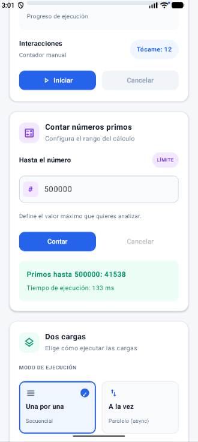
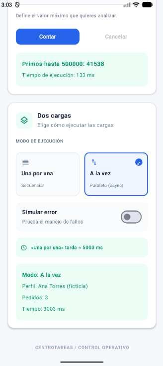
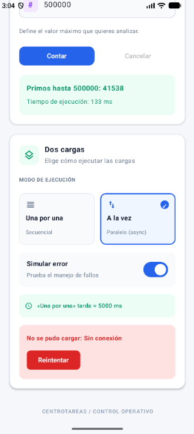

# CentroTareas — Laboratorio N° 14 (Hilos, Corrutinas y StateFlow en Android)

**Proyecto:** CentroTareas  
**Asignación:** Laboratorio N° 14 — Hilos, Corrutinas y StateFlow en Android con Jetpack Compose y Arquitectura MVVM + Repository.  
**Paquete Base:** `com.quijada.centrotareas`

---

## 1. Descripción del Proyecto
**CentroTareas** es una aplicación Android moderna desarrollada íntegramente en **Kotlin** y **Jetpack Compose** (Material 3 sin XML). Su objetivo principal es demostrar y aplicar conceptos avanzados de concurrencia en Android, tales como la gestión de hilos, prevención de bloqueos de la interfaz de usuario (*UI Freeze*), corrutinas estructuradas, emisión reactiva de estados con `StateFlow`, cancelación cooperativa de tareas pesadas, concurrencia paralela (`async`/`await`) y manejo seguro de excepciones de red con recuperación.

---

## 2. Árbol de Paquetes del Proyecto
```text
app/src/main/java/com/quijada/centrotareas/
├── MainActivity.kt
├── data/
│   ├── TareasRepository.kt
│   └── TareasRepositoryLocal.kt
├── model/
│   └── Estados.kt
├── ui/
│   ├── PantallaTareas.kt
│   └── theme/
│       ├── Color.kt
│       ├── Theme.kt
│       └── Type.kt
└── viewmodel/
    ├── TareasViewModel.kt
    └── TareasViewModelFactory.kt
```

---

## 3. Diagrama Arquitectónico (MVVM + Repository)
El flujo de datos en CentroTareas es estrictamente unidireccional, desacoplando la interfaz de usuario de la lógica de negocio y del origen de datos mediante interfaces y corrutinas *main-safe*.



---

## 4. Observación del Paso 1: Bloqueo del Hilo Principal (UI Freeze)
### (a) ¿Qué ocurre con la UI durante los 4 segundos?
Al pulsar el botón **"Tarea larga (MAL)"**, la interfaz de usuario se congela por completo durante 4 segundos exactos. Durante este intervalo, la aplicación no procesa ningún evento táctil ni animación; el botón **"Tócame: $contador"** deja de responder de inmediato.

### (b) ¿Por qué no se llega a dibujar "Trabajando..." antes del bloqueo?
Aunque en el código la instrucción `_mensaje.value = "Trabajando..."` se ejecuta cronológicamente antes de la pausa, el cambio en el `StateFlow` únicamente programa un evento de recomposición en la cola de mensajes del hilo principal (*main thread*). Inmediatamente después, la llamada bloqueante `Thread.sleep(4000)` paraliza el hilo `main`, impidiendo que el motor de Jetpack Compose procese el ciclo de renderizado y pinte el texto en pantalla. Cuando el hilo despierta, el estado ya cambió a `"Terminó"`, por lo que la UI solo dibuja el resultado final.

### (c) ¿Qué pasaría si la espera fuera de 10 segundos?
Si la operación bloqueante se extendiera por 10 segundos en el hilo principal sin atender eventos de entrada, el sistema operativo Android consideraría que la aplicación no responde y mostraría el diálogo de sistema **ANR (*Application Not Responding*)**, dando al usuario la opción de forzar el cierre de la app.

---

## 5. Capturas de Sucesos y Ejecución

| Tarea con Progreso | Tarea Cancelada |
| :---: | :---: |
|  |  |

| Contar Números Primos | Dos Cargas en Paralelo | Error Simulado y Reintento |
| :---: | :---: | :---: |
|  |  |  |

---

## 6. Para Pensar: Preguntas y Respuestas Teóricas

### Pregunta 1: ¿Por qué no se veía `"Trabajando..."` en el Paso 1?
**Respuesta:** Porque `Thread.sleep` bloquea físicamente el hilo principal (`main`), impidiendo que el bucle de mensajes procese los eventos de dibujo y recomposición de Jetpack Compose antes de que el estado vuelva a cambiar a `"Terminó"`.

### Pregunta 2: ¿Qué diferencia hay entre `Thread.sleep` y `delay`?
**Respuesta:** `Thread.sleep` detiene de forma síncrona y bloqueante el hilo del sistema operativo, desperdiciando recursos y congelando la UI. Por el contrario, `delay` es una función de suspensión no bloqueante que libera el hilo para atender otras tareas (como eventos de UI o renderizado) y reanuda la corrutina transcurrido el tiempo especificado.

### Pregunta 3: ¿Por qué `Dispatchers.Default` para los primos y `Dispatchers.IO` para la red?
**Respuesta:** `Dispatchers.Default` está optimizado para procesamiento intensivo de CPU con un pool de hilos limitado al número de núcleos del procesador. `Dispatchers.IO` está diseñado para operaciones de entrada/salida (espera de red, lectura de disco) con un pool de hilos mucho más amplio para evitar bloqueos por latencia externa.

### Pregunta 4: ¿Qué pasaría con la corrutina si el usuario cierra la pantalla? ¿Qué papel cumple `viewModelScope`?
**Respuesta:** Si el usuario abandona la pantalla, el `ViewModel` asociado es destruido y su `viewModelScope` cancela automáticamente todas las corrutinas hijas en curso, evitando fugas de memoria y consumo innecesario de CPU.

### Pregunta 5: ¿Por qué `async` tarda 3 s y no 5 s? ¿Qué pasa si una de las dos cargas falla?
**Respuesta:** Tarda 3 segundos porque `async` lanza ambas tareas de forma concurrente, por lo que el tiempo total equivale al máximo de ambas ($\max(2\text{ s}, 3\text{ s}) = 3\text{ s}$) en lugar de la suma secuencial ($2\text{ s} + 3\text{ s} = 5\text{ s}$). En cuanto a errores, bajo la concurrencia estructurada de `coroutineScope`, si una de las corrutinas hijas falla con una excepción no manejada, cancela inmediatamente a su hermana y propaga el error hacia arriba.
