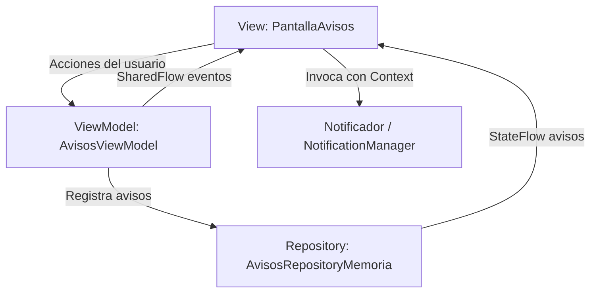
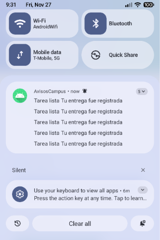
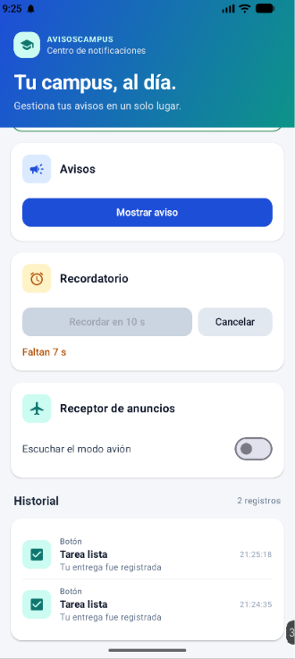
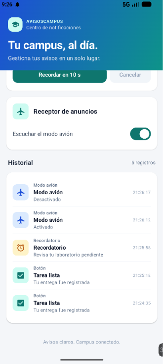
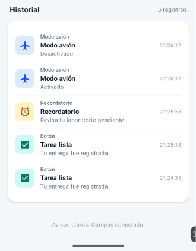
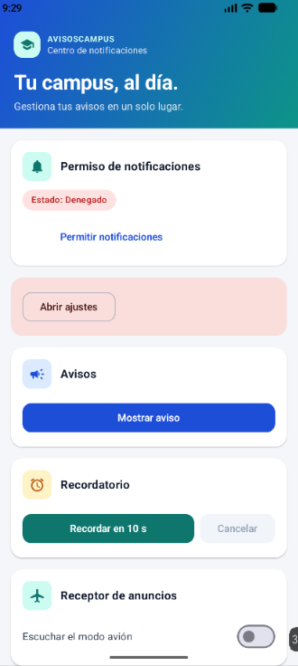

# AvisosCampus

**AvisosCampus** es una aplicación móvil nativa para Android desarrollada en **Kotlin**, **Jetpack Compose** y **Material 3**. La aplicación gestiona notificaciones locales con canales de notificación (Android 8.0+) y permisos dinámicos en tiempo de ejecución (Android 13+), además de programar recordatorios con cuenta regresiva mediante corrutinas, interceptar cambios en el estado del dispositivo (modo avión) a través de un `BroadcastReceiver` y almacenar un historial de eventos en memoria bajo la arquitectura **MVVM + Repository**.

---

## 1. Estructura de Paquetes

```text
com.tecsup.avisoscampus/
├── AvisosApp.kt                      [G] Inicialización del Application y canal de notificaciones
├── MainActivity.kt                   [E] Punto de entrada principal e inyección manual
├── model/
│   └── Modelos.kt                    [E] Definición de clases de datos (Aviso, Origen, PermisoUi)
├── data/
│   └── AvisosRepository.kt           [E] Interfaz AvisosRepository e implementación AvisosRepositoryMemoria
├── notificacion/
│   └── Notificador.kt                [G] Objeto notificador, verificación de permisos y NotificationCompat
├── receiver/
│   └── ModoAvionReceiver.kt          [A] BroadcastReceiver para capturar cambios en el modo avión
├── viewmodel/
│   ├── AvisosViewModel.kt            [G] Lógica de negocio, estados y flujo de eventos
│   └── AvisosViewModelFactory.kt     [E] Fábrica para inyección del repositorio en el ViewModel
└── ui/
    ├── PantallaAvisos.kt             [G] UI principal con Jetpack Compose y manejo del ciclo de vida
    ├── HistorialAvisos.kt            [A] Tarjeta/lista del historial de avisos registrados
    └── theme/                        [E] Configuración de tema, colores y tipografía Material 3
```

---

## 2. Diagrama de Arquitectura (MVVM + Repository)

El proyecto sigue una arquitectura con flujo unidireccional de datos (UDF) y separación estricta de responsabilidades:



### Flujo de Notificaciones:
1. La **View (`PantallaAvisos`)** captura la interacción del usuario y llama a un método del **ViewModel (`AvisosViewModel`)**.
2. El **ViewModel** ejecuta la lógica de negocio, registra el evento en **`AvisosRepositoryMemoria`** y emite un aviso de un solo uso mediante un **`SharedFlow<Aviso>`**.
3. El **ViewModel** no contiene referencias a `Context`, `NotificationManager` ni `BroadcastReceiver`.
4. La **View**, al recolectar el evento y contar con el `Context` activo, delega la creación y despliegue de la notificación nativa al **`Notificador`**.

---

## 3. Capturas de Pantalla

| Notificación en el Panel | Recordatorio con Cuenta Regresiva |
| :---: | :---: |
|  |  |

| Aviso de Modo Avión | Historial de Avisos | Permiso Denegado |
| :---: | :---: | :---: |
|  |  |  |

---

## 4. Respuestas a "Para pensar"

### 1. ¿Por qué una notificación necesita un canal y un permiso? ¿Qué pasa si falta cada uno?
* **Canal (`NotificationChannel` - Android 8.0 / API 26+):** Categoriza las notificaciones para que el usuario pueda personalizar su comportamiento (sonido, vibración, importancia o bloqueo) directamente desde los ajustes del sistema sin tener que deshabilitar todas las notificaciones de la aplicación. **Si falta el canal en Android 8.0+**, el sistema descarta la notificación silenciosamente y no se muestra en pantalla.
* **Permiso (`POST_NOTIFICATIONS` - Android 13 / API 33+):** Protege la privacidad del usuario requiriendo su autorización explícita en tiempo de ejecución antes de mostrar notificaciones en la barra de estado. **Si falta la declaración en el `AndroidManifest.xml` o el usuario niega el permiso**, la llamada a enviar notificaciones es bloqueada por el sistema operativo y no se desplegará ningún aviso.

### 2. ¿Por qué el ViewModel emite un evento y no muestra la notificación él mismo?
Para respetar el principio de responsabilidad única (SRP) y mantener el ViewModel completamente independiente del marco de trabajo de Android. El ViewModel debe ocuparse únicamente de la lógica de negocio y del estado de la aplicación. Mantenerlo libre de `Context`, `NotificationManager` o `BroadcastReceiver` evita fugas de memoria (*memory leaks*) y permite realizar **pruebas unitarias puras** en la JVM sin necesidad de simular o mockear componentes del sistema Android.

### 3. ¿Qué pasa si usas el mismo `id` en dos notificaciones?
Si se envía una nueva notificación utilizando el mismo identificador numérico (`id`) que una notificación que actualmente se encuentra visible en la barra de estado, **la notificación anterior es reemplazada/actualizada** inmediatamente por la nueva en lugar de mostrar dos notificaciones separadas. Para mostrar múltiples notificaciones simultáneas de manera independiente, cada una debe poseer un `id` único.

### 4. ¿Por qué `onReceive` debe ser corto y por qué hay que quitar el receptor al salir?
* **`onReceive` corto:** `onReceive` en un `BroadcastReceiver` se ejecuta directamente en el hilo principal de la interfaz de usuario (*UI Thread*). Si realiza operaciones pesadas o bloqueantes (I/O, red, procesamiento extenso), la aplicación se congelará y el sistema operativo lanzará un error de tipo **ANR** (*Application Not Responding*).
* **Desregistrar el receptor:** Es obligatorio remover/desregistrar el receptor (`unregisterReceiver`) al destruir el componente o cambiar de estado (por ejemplo, en el bloque `onDispose` de `DisposableEffect`), ya que de lo contrario el receptor permanecerá activo en el sistema provocando una fuga de memoria y consumiendo recursos innecesarios al escuchar eventos cuando la UI ya no existe.

### 5. ¿En qué casos usarías una notificación local y en cuáles una push de Firebase?
* **Notificaciones Locales:** Se utilizan cuando el evento es generado y programado dentro del propio dispositivo del usuario sin requerir un servidor externo. Ejemplos: alarmas, recordatorios con temporizadores, eventos del sistema en tiempo real (modo avión, batería baja, descarga de archivo completada).
* **Notificaciones Push (Firebase Cloud Messaging - FCM):** Se utilizan cuando el evento se origina remotamente en un servidor o servicio backend externo y debe notificarse a un usuario específico o a un grupo de dispositivos. Ejemplos: mensajes de chat entrantes, publicaciones nuevas, ofertas personalizadas, alertas globales del sistema escolar o empresarial.
